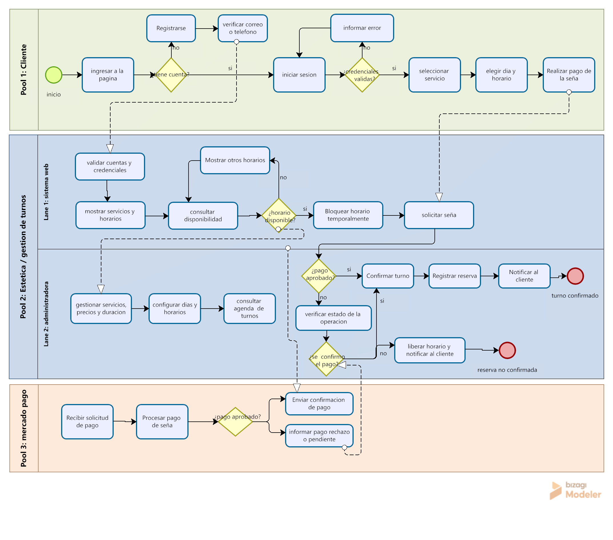

# Proceso de Registro y Reserva de Turnos

## Descripción
Este documento describe el proceso que realiza un cliente
para registrarse, iniciar sesión y solicitar un turno
en el sistema web de gestión de la estética.

## Participantes
- Cliente.
- Sistema web.
- Administradora.
- Mercado Pago.

## Diagrama BPMN

## Observaciones
La documentación se encuentra en proceso de elaboración.
